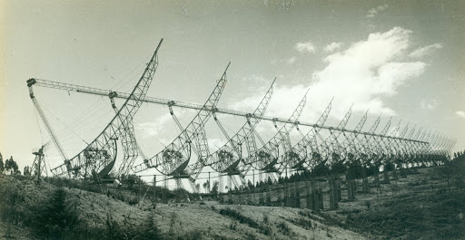
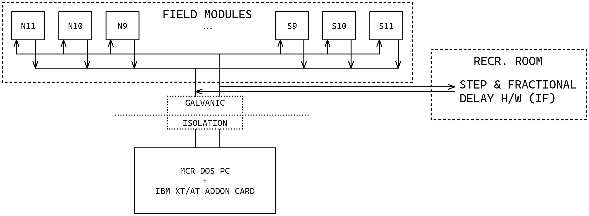
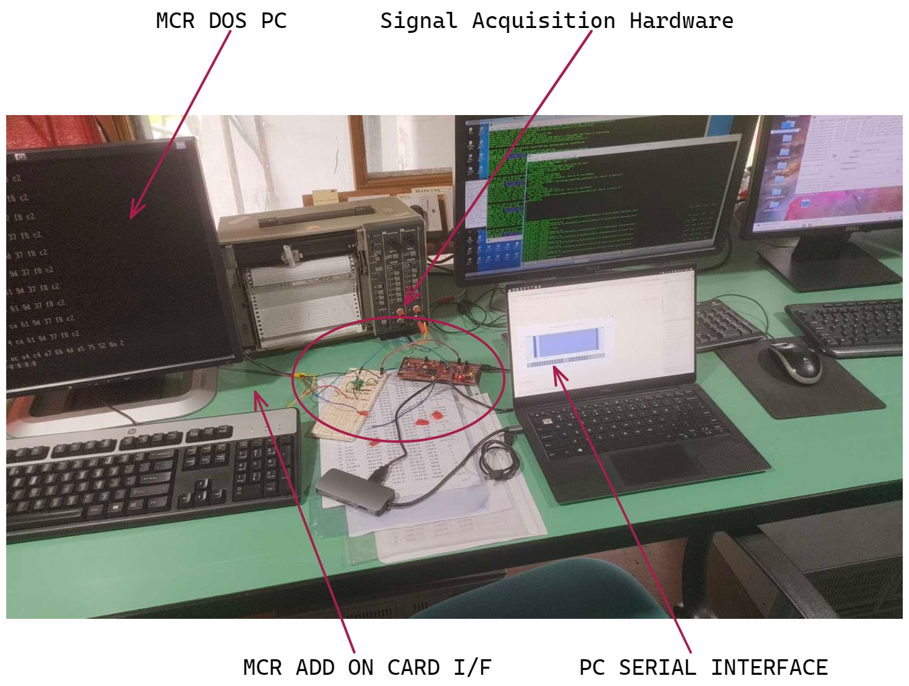
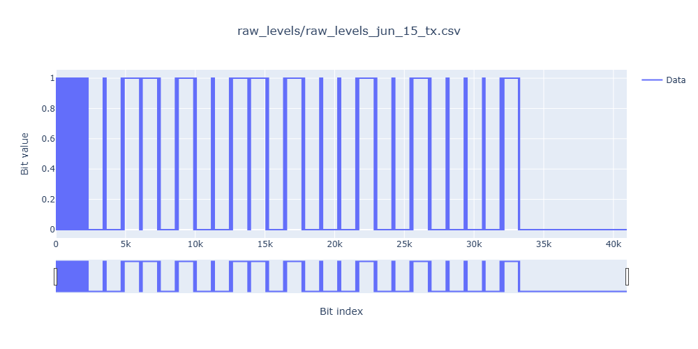
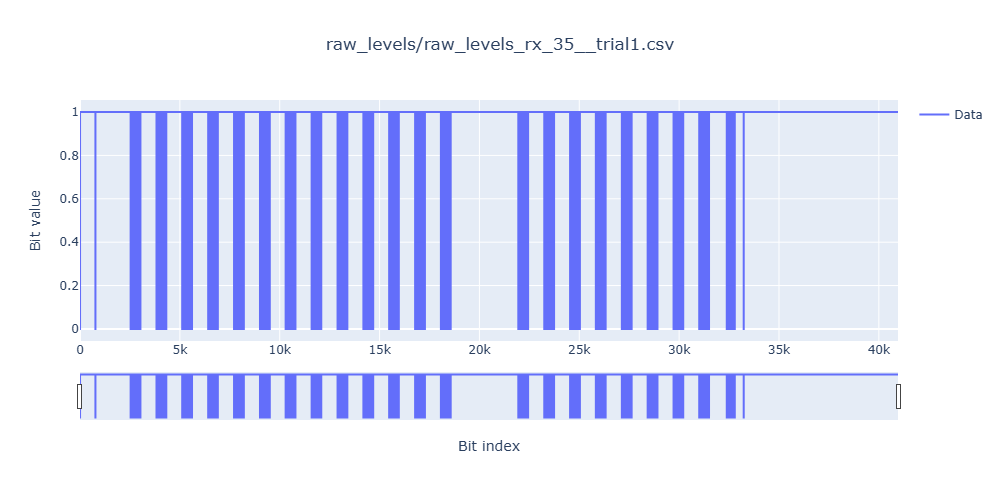
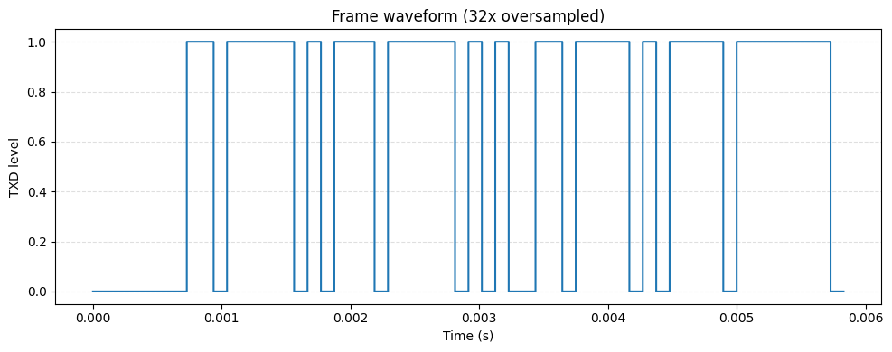
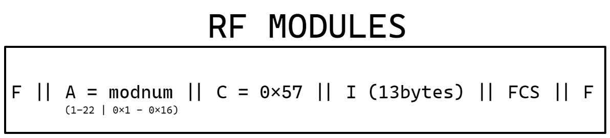
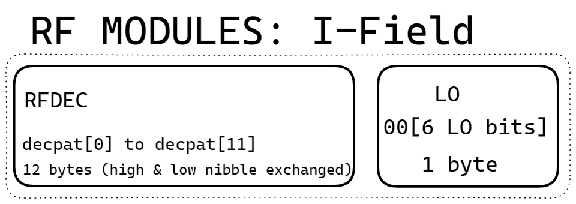
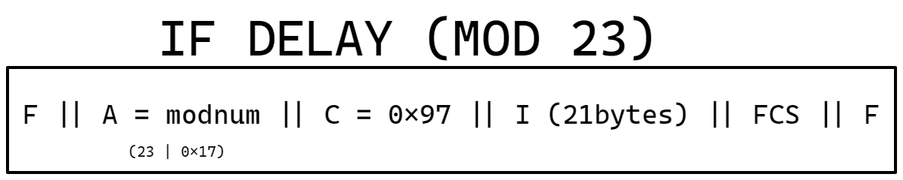
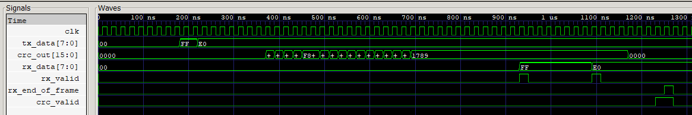

# Ooty Radio Telescope — Declination Control System

**Reverse Engineering | Hardware Monitoring | SDLC/NRZI Protocol Analysis | FPGA Prototyping**

*Summer 2026 · Radio Astronomy Centre, NCRA–TIFR, Ooty, India*

An engineering investigation into the legacy Declination (DEC) Control System of the Ooty Radio Telescope, undertaken during my summer internship at NCRA–TIFR.

The project involved reverse-engineering the existing control software and hardware, building a custom signal acquisition system to capture live SDLC traffic, decoding the underlying protocol, and developing a modular SystemVerilog controller as a proof of concept for future modernization.



## Legacy System Architecture



*Simplified architecture of the legacy Declination Control System.
An IBM XT/AT-based Master Control Room communicates with
distributed field modules over an isolated multidrop SDLC link.
The field modules configure the antenna's delay hardware,
while the receiver-room system handles the IF delay path.*

The existing system relies on Intel 8273 SDLC controllers
and legacy DOS-based control software. Understanding this
communication path was the first step toward developing
a modern FPGA-based replacement interface.

## 1. Background

The Ooty Radio Telescope (ORT) is a cylindrical radio telescope whose North–South beam steering is performed electronically using discrete microstrip phase-delay elements distributed across the antenna array.

The Declination Control System is responsible for configuring these delay elements and reading back their operational status.

The existing architecture relies on an IBM PC/XT/AT-based Master Control Room (MCR), Intel 8273 SDLC controllers, and distributed field modules communicating over an electrically isolated multidrop bus.

Modernizing this system first required understanding its command structures, physical-layer signaling, clock recovery, and telemetry behavior.

**The engineering objective was to reconstruct and verify the communication interface well enough to support a modern FPGA-based replacement.**

## 2. Engineering Approach

The work was divided into three stages:

| Stage | Work |
|---|---|
| **Reverse engineering** | Reconstructed command formats, addressing, LO phase-control fields, and telemetry parsing from legacy DOS-era C software and hardware documentation. |
| **Physical monitoring** | Developed a TI C2000-based hardware sniffer with external signal conditioning to capture live SDLC/NRZI traffic from the legacy control bus. |
| **FPGA prototyping** | Implemented and simulated a modular SystemVerilog SDLC controller supporting framing, bit stuffing, NRZI coding, and CRC generation/verification. |

## 3. Hardware Monitoring and Protocol Recovery

One of the main challenges was acquiring the serial data stream reliably.

The legacy Intel 8273 controller uses a DPLL-derived receive clock. Initial attempts to detect its narrow clock pulses directly using the TI C2000 microcontroller were unsuccessful.

Oscilloscope measurements indicated pulses approximately 300 ns wide.

A **74LS123 retriggerable monostable** was introduced to stretch these pulses to approximately 1 µs, allowing reliable interrupt-driven sampling using the C2000.



The acquisition system captured raw line levels, buffered them on the microcontroller, and transferred the data to a host PC through a UART interface.

Python tools were then used to reconstruct the SDLC frames from the captured NRZI signals.

### Captured physical-layer signals

**MCR transmission**



**Field-module telemetry**



The decoding pipeline involved NRZI decoding, SDLC flag identification, bit unstuffing, frame extraction, and CRC verification.

A separate Python reference model was also developed to generate synthetic SDLC frames and compare their expected physical-layer behavior with captured traffic.



## 4. Reconstructed SDLC Protocol

The legacy system uses SDLC framing with the following general structure:

```text
FLAG | ADDRESS | CONTROL | INFORMATION | FCS | FLAG
0x7E |   8 b   |   8 b   |   Variable  | 16 b| 0x7E
```

The investigation established the command structures used for power control, RF declination configuration, IF delay configuration, and telemetry reception.

### RF Declination Configuration

RF control frames address field modules 1–22 and contain a 13-byte Information field.

```text
FLAG | Module Address | 0x57 | 13-byte Payload | FCS | FLAG
```

The final payload byte includes six bits associated with local-oscillator phase control.





### IF Declination Configuration

The IF delay configuration targets Module 23 and uses a 21-byte Information field.

```text
FLAG | 0x17 | 0x97 | 21-byte Payload | FCS | FLAG
```



### CRC and Line Encoding

The link uses:

- NRZI coding, with logical zero represented by a transition.
- Zero insertion after five consecutive ones.
- SDLC frame delimiters (`0x7E`).
- A 16-bit CRC-CCITT FCS using polynomial `0x1021`, implemented with the reflected polynomial `0x8408` for LSB-first processing.

The Python decoding tools were used to compare calculated CRC values with the captured frame-check sequences, providing an independent check of the reconstructed protocol.

## 5. Observations from the Legacy System

Two findings were particularly relevant to understanding and eventually replacing the control interface.

**LO phase correction**

The LO phase-control bits are not simply fixed configuration values. The legacy software combines calibration values with declination-dependent residual phase corrections.

A replacement control system therefore needs to preserve the host-side phase calculation and configuration behavior.

**IF telemetry anomaly**

During physical monitoring, the IF module repeatedly returned a 42-byte telemetry payload consisting of `0xAA` values.

Under the legacy bit-interleaving and masking scheme, this produces an implausible combination of uniformly asserted data bits and cleared error indicators.

The observation identified an anomaly in the telemetry path requiring further investigation; the precise hardware cause was not established.

## 6. SystemVerilog SDLC Controller

The decoded protocol was used to develop a modular RTL proof of concept for a modern SDLC communication interface.

The design includes:

- NRZI encoder and decoder
- TX bit stuffer and RX bit unstuffer
- CRC-CCITT generation and checking
- TX and RX framing state machines
- Functional testbenches and loopback verification

### RTL Loopback Verification



The loopback simulation exercises frame transmission and reception through the implemented protocol stages, including CRC checking.

**Status:** RTL functional proof of concept. This work does not represent a completed field-deployed replacement of the existing control system.

## 7. Project Outcomes

The internship produced:

1. A reconstructed description of the legacy DEC command and telemetry protocol.
2. A working physical-layer monitoring approach using a TI C2000 and external clock-pulse conditioning.
3. Python tools for generating, decoding, visualizing, and verifying SDLC/NRZI frames.
4. Identification of an anomalous IF telemetry response.
5. A modular SystemVerilog SDLC controller with functional simulation and loopback verification.

Together, these establish a technical foundation for further development of a modern control-room interface.

## 8. Technical Report

The complete internship report contains the system architecture, protocol analysis, hardware troubleshooting, captured-data observations, RTL microarchitecture, and implementation appendices.

**[Read the full technical report](docs/ORT_Declination_Control_System_Report.pdf)**

## 9. Tools and Technologies

**Hardware:** TI TMS320F28379D C2000, 74LS123, Intel 8273 SDLC interface, oscilloscopes, logic-level signal conditioning.

**RTL:** SystemVerilog, framing FSMs, NRZI, CRC-CCITT, bit stuffing, loopback verification.

**Software:** C, Python, Jupyter, NumPy, pandas, serial acquisition and waveform visualization.

## Acknowledgements

This work was carried out during my summer internship at the Radio Astronomy Centre, NCRA–TIFR, Ooty, under the guidance of Sameer R. Bharadwaj.

The repository documents my engineering work and learning during the project. It is not an official NCRA–TIFR control-system release.

---

*Jayanth Krish · Electronics and Communication Engineering · MIT Manipal · Summer 2026*